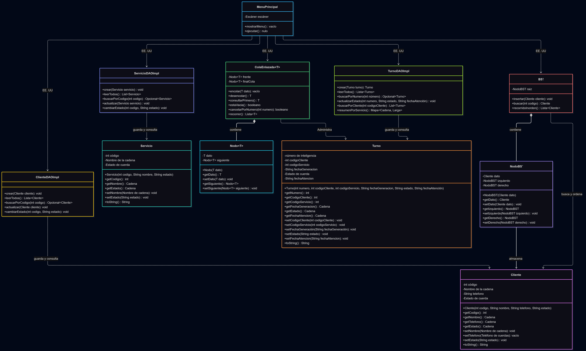
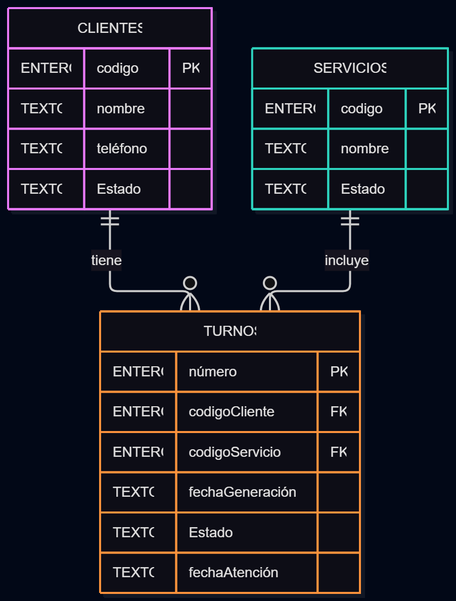

# Sistema de Gestión de Turnos - Grupo 9

Aplicación de consola desarrollada en Java para administrar la atención de clientes en una oficina de servicios. El sistema permite registrar clientes, gestionar servicios, generar turnos y atenderlos en orden de llegada, utilizando estructuras de datos propias y persistencia en una base de datos SQLite.

## Tecnologías y requisitos

- **Lenguaje:** Java 21.
- **Base de datos:** SQLite, almacenada localmente en `data/turnos.db`.
- **Conectividad:** JDBC.
- **Dependencia:** `sqlite-jdbc-3.36.0.3.jar`, incluida en `lib/`.
- **Sistema de construcción:** Maven.

## Estructuras de datos implementadas

1. **Cola enlazada propia (`ColaEnlazada<T>`):** administra los turnos pendientes respetando el orden FIFO. Incluye las operaciones `encolar`, `desencolar`, `consultarPrimero`, `cancelarPorNumero` y `recorrer`.
2. **Árbol binario de búsqueda propio (`BST`):** almacena clientes y permite buscarlos por código. La búsqueda y el recorrido inorden se implementan mediante recursividad.
3. **Nodos propios:** `Nodo<T>` para la cola enlazada y `NodoBST` para el árbol binario de búsqueda.

## Cómo ejecutar el proyecto

### Opción 1: Ejecutar con Maven

Desde la carpeta raíz del proyecto:

```bash
mvn clean compile
mvn exec:java -Dexec.mainClass="com.turnos.Inicializador"
mvn exec:java -Dexec.mainClass="com.turnos.Main"
```

El inicializador crea o recrea las tablas de la base de datos y carga los datos iniciales definidos en `sql/crear_y_cargar.sql`. Después, `Main` inicia el menú de consola.

### Opción 2: Compilar y ejecutar manualmente

En Windows, desde la carpeta raíz del proyecto:

```powershell
New-Item -ItemType Directory -Force target\classes
javac -encoding UTF-8 -cp "lib\sqlite-jdbc-3.36.0.3.jar" -d target\classes (Get-ChildItem -Recurse -Filter *.java src\main\java).FullName
java -cp "target\classes;lib\sqlite-jdbc-3.36.0.3.jar" com.turnos.Inicializador
java -cp "target\classes;lib\sqlite-jdbc-3.36.0.3.jar" com.turnos.Main
```

En Linux o macOS, use `:` en lugar de `;` como separador del classpath y `/` en lugar de `\` en las rutas.

## Flujo de uso

1. Ejecutar `Inicializador` para crear la base de datos y cargar los datos iniciales.
2. Ejecutar `Main` para abrir el menú principal.
3. Registrar o consultar clientes y servicios.
4. Generar un turno seleccionando un cliente y un servicio activos.
5. Atender los turnos pendientes en orden de llegada.
6. Cancelar turnos pendientes cuando sea necesario.
7. Consultar turnos pendientes, atendidos, cancelados, el historial de un cliente y el resumen por servicio.
8. Seleccionar **Salir** para cerrar la aplicación.

## Funcionalidades principales

- Gestión de clientes: registrar, consultar, buscar, actualizar y activar o desactivar.
- Gestión de servicios: registrar, consultar, buscar, actualizar y activar o desactivar.
- Generación automática de números de turno.
- Validación de teléfonos, estados, códigos y datos obligatorios.
- Atención de turnos mediante una cola FIFO.
- Persistencia de clientes, servicios y turnos en SQLite.
- Consultas de historial y resumen de turnos por servicio.

## Estructura del proyecto

```text
GRUPO 9/
├── data/
│   └── turnos.db
├── lib/
│   └── sqlite-jdbc-3.36.0.3.jar
├── sql/
│   └── crear_y_cargar.sql
├── src/
│   └── main/
│       └── java/
│           └── com/
│               └── turnos/
│                   ├── Inicializador.java
│                   ├── Main.java
│                   ├── dao/
│                   ├── estructuras/
│                   ├── modelo/
│                   ├── negocio/
│                   └── vista/
├── pom.xml
└── README.md
```

### Responsabilidad de los paquetes

- `com.turnos.modelo`: entidades del sistema (`Cliente`, `Servicio` y `Turno`).
- `com.turnos.estructuras`: estructuras de datos propias.
- `com.turnos.dao`: conexión SQLite, interfaces y operaciones de acceso a datos.
- `com.turnos.negocio`: reglas de negocio y coordinación de las estructuras y los DAO.
- `com.turnos.vista`: menú e interacción con el usuario.
- `com.turnos`: clases de entrada (`Main`) e inicialización de la base de datos.


## Diagramas del Sistema

### Diagrama de Clases (UML)


### Diagrama Entidad-Relación (DER)



## Integrantes del Grupo 9

- Rubí Ester Marroqin Carias Carne:0905-24-11744
- Ericson José Cristales Rivera Carne:5190-24-10720
- Nombre del integrante 3


